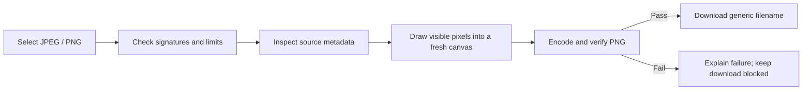

# AssetSanitize

**Self-initiated studio project · ConsoleLog Studio**

## The workflow problem

A photographer or creative agency may want to share an image without carrying its embedded location, device serial, author, or capture-time fields into the shared file. A changed filename does not address those fields. AssetSanitize makes the inspection and cleanup visible in one small workflow.

The first version supports static JPEG and PNG. It is a portfolio demonstration, not commissioned client work or evidence of customer adoption.

## The smallest useful product

Choose images, inspect recognized metadata, reconstruct the pixels as PNG, verify the output, and download it. All selected content stays on the visitor's device. The free-hosting constraint led to a statically exported Next.js application with no backend, database, processing API, or account system.

## The actual product

1. **A direct start:** the empty desktop workspace presents the uploader and a synthetic sample without a separate marketing page. [Desktop start](portfolio/desktop-empty.png).
2. **Evidence before action:** grouped source fields expose demonstration GPS, device serial, author, and capture time beside the image. [Metadata inspection](portfolio/desktop-inspection.png).
3. **A checked result:** the PNG becomes downloadable only after structure and metadata checks; its real size is shown even when it grows. [Verified result](portfolio/desktop-result.png).
4. **The same workflow on a phone viewport:** queue, preview, metadata, and results stack without page-level horizontal scrolling. [Mobile workflow](portfolio/mobile-result.png).

## Decisions visible to the user

- Local processing avoids sending image bytes or filenames to a processing service.
- A fresh raster export avoids carrying source EXIF, XMP, IPTC, text, thumbnails, and profiles into the output.
- A strict PNG allowlist and independent test inspection make verification a release condition.
- Sequential work, cancellation, and isolated errors keep a useful result available even when another file fails.
- Generic filenames avoid carrying a private source filename into a downloaded result.
- Browser differences were treated as actual compatibility work. Firefox-generated session information and WebKit technical bit-depth metadata are narrowly removed after review, then the same verifier runs.

## Verification and limits

See the [acceptance report](verification.md) for commands, actual results, browser versions, evidence, and untested environments. Screenshots use synthetic data. No customer outcomes, time savings, or security certifications are claimed.

The tool does not remove visible text, faces, or identifying scene content. Output can be larger, high-bit-depth/color interpretation can change, and device memory remains a practical constraint. Unsupported or unverifiable files fail visibly.

Try the [live demo](https://assetsanitize.pages.dev/) or read the [source on GitHub](https://github.com/shawalkabirchy/AssetSanitize). [Discuss a workflow with ConsoleLog Studio](https://consolelog.studio/).
